# Learn Stripe 💳

<div align="center">

[](https://opensource.org/licenses/MIT)
[](https://docs.stripe.com/api)
[](https://nodejs.org/)
[](https://www.typescriptlang.org/)
[](https://expressjs.com/)
[](https://github.com/TheLearningHubOrg/learn-stripe)

**An exhaustive, production-grade masterclass from absolute zero to staff-level Stripe payments architecture.**  
Master Checkout and Payment Intents, signature-verified webhooks, idempotent fulfillment, subscriptions and billing, refunds and disputes, Connect marketplaces, and disciplined test-mode workflows.

[Getting Started](#1-stage-1-absolute-beginner-foundations--the-payments-mental-model) • [Checkout](#2-stage-2-stripe-checkout--hosted-payment-flows) • [Payment Intents](#3-stage-3-payment-intents-sca--custom-payment-flows) • [Webhooks](#4-stage-4-webhooks-signatures--event-driven-fulfillment) • [Subscriptions & Refunds](#5-stage-5-subscriptions-billing-refunds--disputes) • [Connect & Test Mode](#6-stage-6-connect-test-mode-workflows--production-operations) • [Staff Handbook](#7-stage-7-staff-payments-architect-interview-handbook--cheatsheet)

<br/>

<a href="https://www.buymeacoffee.com/manthanank">
  
</a>

</div>

---

## 🗺️ 7-Stage Pedagogical Roadmap

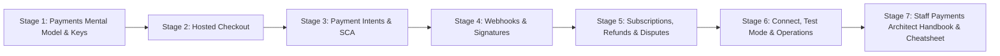

| Stage | Domain Focus | Core Concepts & Production Outcomes |
| :--- | :--- | :--- |
| **Stage 1** | **Payments Foundations & Object Model** | Card network flow, test vs live mode, `pk_`/`sk_`/`rk_` keys, `PaymentIntent`, `Customer`, `Price`, `Event`, minor-unit integer amounts, error types and request IDs. |
| **Stage 2** | **Stripe Checkout & Hosted Flows** | `checkout.sessions.create`, server-side catalogs, `client_reference_id`, success URLs with `{CHECKOUT_SESSION_ID}`, idempotency keys, embedded Checkout and Payment Links. |
| **Stage 3** | **Payment Intents & Custom Flows** | The `PaymentIntent` state machine, Payment Element, `requires_action` and 3D Secure, manual capture, `SetupIntent`, off-session charges and `authentication_required` recovery. |
| **Stage 4** | **Webhooks & Event-Driven Fulfillment** | `Stripe-Signature` HMAC-SHA256 scheme, replay tolerance, raw-body parsing in Express, at-least-once delivery, event deduplication, out-of-order handling, Stripe CLI forwarding. |
| **Stage 5** | **Subscriptions, Billing, Refunds & Disputes** | Recurring `Price` objects, subscription statuses, `invoice.paid` vs `invoice.payment_failed`, Smart Retries, Customer Portal, proration, partial refunds, dispute evidence. |
| **Stage 6** | **Connect, Test Mode & Production Ops** | Destination vs direct charges, `application_fee_amount`, Account Links onboarding, test cards, sandboxes, test clocks, restricted keys, PCI scope, Radar, Docker deployment. |
| **Stage 7** | **Staff Payments Architect Handbook** | 40 staff-level scenario Q&As, double-charge prevention, reconciliation, webhook outages, marketplace liability, and an enterprise command cheatsheet. |

---

## 📋 Table of Contents
- [1. Stage 1: Absolute Beginner Foundations & the Payments Mental Model](#1-stage-1-absolute-beginner-foundations--the-payments-mental-model)
  - [1.1 How a Card Payment Actually Moves](#11-how-a-card-payment-actually-moves)
  - [1.2 Accounts, Modes & API Keys](#12-accounts-modes--api-keys)
  - [1.3 The Core Object Model](#13-the-core-object-model)
  - [1.4 Money as Integers: Minor Units & Currencies](#14-money-as-integers-minor-units--currencies)
  - [1.5 Your First API Calls (curl & Node.js)](#15-your-first-api-calls-curl--nodejs)
  - [1.6 Errors, Request IDs & API Versioning](#16-errors-request-ids--api-versioning)
- [2. Stage 2: Stripe Checkout & Hosted Payment Flows](#2-stage-2-stripe-checkout--hosted-payment-flows)
  - [2.1 Choosing an Integration Surface](#21-choosing-an-integration-surface)
  - [2.2 Creating a Checkout Session on the Server](#22-creating-a-checkout-session-on-the-server)
  - [2.3 Products, Prices & the Server-Side Catalog](#23-products-prices--the-server-side-catalog)
  - [2.4 Success Pages Are Not Proof of Payment](#24-success-pages-are-not-proof-of-payment)
  - [2.5 Idempotency Keys & Safe Retries](#25-idempotency-keys--safe-retries)
  - [2.6 Embedded Checkout, Payment Links & Customisation](#26-embedded-checkout-payment-links--customisation)
- [3. Stage 3: Payment Intents, SCA & Custom Payment Flows](#3-stage-3-payment-intents-sca--custom-payment-flows)
  - [3.1 The PaymentIntent State Machine](#31-the-paymentintent-state-machine)
  - [3.2 Server: Creating a PaymentIntent](#32-server-creating-a-paymentintent)
  - [3.3 Client: The Payment Element](#33-client-the-payment-element)
  - [3.4 Strong Customer Authentication & 3D Secure](#34-strong-customer-authentication--3d-secure)
  - [3.5 Authorise Now, Capture Later](#35-authorise-now-capture-later)
  - [3.6 SetupIntents & Off-Session Charges](#36-setupintents--off-session-charges)
- [4. Stage 4: Webhooks, Signatures & Event-Driven Fulfillment](#4-stage-4-webhooks-signatures--event-driven-fulfillment)
  - [4.1 Why Webhooks Are the Source of Truth](#41-why-webhooks-are-the-source-of-truth)
  - [4.2 Anatomy of the Stripe-Signature Header](#42-anatomy-of-the-stripe-signature-header)
  - [4.3 Raw Bodies in Express](#43-raw-bodies-in-express)
  - [4.4 Idempotent, Order-Independent Handlers](#44-idempotent-order-independent-handlers)
  - [4.5 Retries, Queues & Backpressure](#45-retries-queues--backpressure)
  - [4.6 Local Development with the Stripe CLI](#46-local-development-with-the-stripe-cli)
- [5. Stage 5: Subscriptions, Billing, Refunds & Disputes](#5-stage-5-subscriptions-billing-refunds--disputes)
  - [5.1 Recurring Prices & Subscription Checkout](#51-recurring-prices--subscription-checkout)
  - [5.2 The Subscription Lifecycle](#52-the-subscription-lifecycle)
  - [5.3 Invoices, Dunning & the Customer Portal](#53-invoices-dunning--the-customer-portal)
  - [5.4 Upgrades, Downgrades & Proration](#54-upgrades-downgrades--proration)
  - [5.5 Refunds: Full, Partial & Asynchronous](#55-refunds-full-partial--asynchronous)
  - [5.6 Disputes & Chargebacks](#56-disputes--chargebacks)
- [6. Stage 6: Connect, Test-Mode Workflows & Production Operations](#6-stage-6-connect-test-mode-workflows--production-operations)
  - [6.1 Connect Architecture & Charge Types](#61-connect-architecture--charge-types)
  - [6.2 Onboarding Connected Accounts](#62-onboarding-connected-accounts)
  - [6.3 Test Mode, Sandboxes & Test Cards](#63-test-mode-sandboxes--test-cards)
  - [6.4 Test Clocks for Billing Scenarios](#64-test-clocks-for-billing-scenarios)
  - [6.5 Security: Keys, PCI Scope & Fraud](#65-security-keys-pci-scope--fraud)
  - [6.6 Running the Companion Service](#66-running-the-companion-service)
  - [6.7 Observability & Go-Live Checklist](#67-observability--go-live-checklist)
- [7. Stage 7: Staff Payments Architect Interview Handbook & Cheatsheet](#7-stage-7-staff-payments-architect-interview-handbook--cheatsheet)
  - [7.1 Enterprise Production Cheatsheet](#71-enterprise-production-cheatsheet)
  - [7.2 Staff & Principal Architect Interview Q&A (40 Scenarios)](#72-staff--principal-architect-interview-qa-40-scenarios)
- [🤝 Contributing](#-contributing)
- [📄 License](#-license)

---

## 1. Stage 1: Absolute Beginner Foundations & the Payments Mental Model

Stripe is a payments platform exposed as a REST API. You send it HTTPS requests with a secret key; it moves money across card networks, bank rails and wallets on your behalf, and it tells you what happened through API responses and asynchronous events. Everything in this guide follows from one idea: **your server decides what to charge, Stripe decides whether the charge worked, and webhooks carry that decision back to you.**

### 1.1 How a Card Payment Actually Moves

A single "Pay" click touches five parties. Understanding who holds the money at each step explains most of the API design.

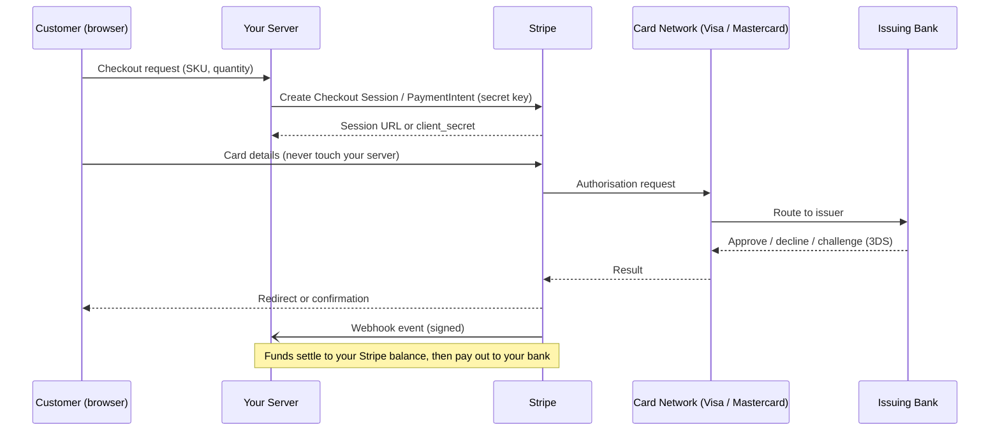

1. **Authorisation**: the issuer checks funds and fraud signals and places a hold. Nothing has moved yet.
2. **Capture**: the merchant claims the held funds. Stripe captures immediately by default.
3. **Clearing & settlement**: the network moves funds from issuer to Stripe over the following days.
4. **Payout**: Stripe transfers your available balance, minus fees, to your bank account on a schedule.
5. **Reversal paths**: refunds (merchant-initiated) and disputes (cardholder-initiated through the issuer) send money backwards.

Bank debits (ACH Direct Debit, SEPA Direct Debit, BACS) are slower: the payment sits in `processing` for days and can still fail after the customer has left your site. This single fact is why fulfillment must be event-driven.

### 1.2 Accounts, Modes & API Keys

Every Stripe account has two fully separate data planes: **test mode** and **live mode**. Objects created in one never appear in the other, and each mode has its own keys and webhook endpoints. Stripe also offers **sandboxes**, isolated test environments you can create per developer, branch or CI pipeline so that teams stop trampling each other's test data.

| Key Prefix | Where It Lives | What It Can Do |
| :--- | :--- | :--- |
| `pk_test_` / `pk_live_` | Browser and mobile apps | Tokenise payment details, confirm intents with a `client_secret`. Safe to publish. |
| `sk_test_` / `sk_live_` | Server only (secrets manager) | Full read/write access to the account. Treat as a root credential. |
| `rk_test_` / `rk_live_` | Server, scoped services | **Restricted key** with per-resource permissions (e.g. write Checkout Sessions, read nothing else). |
| `whsec_` | Server only | Webhook endpoint signing secret, unique per endpoint. |

Production rules that save careers:

1. **Never ship a secret key to a client.** If a `sk_live_` key appears in a bundle, roll it in the Dashboard immediately.
2. **Prefer restricted keys** for every service that does not need full access. A reporting job needs read-only; a checkout service needs Checkout Sessions write.
3. **Fail closed on live keys outside production.** The companion service refuses `sk_live_` unless `STRIPE_ALLOW_LIVE=true` is set deliberately.

```typescript
// src/config.ts (excerpt): refuse live keys unless production opts in
const TEST_KEY = /^(sk|rk)_test_/;
const LIVE_KEY = /^(sk|rk)_live_/;

if (LIVE_KEY.test(stripeSecretKey) && env.STRIPE_ALLOW_LIVE !== 'true') {
  throw new ConfigError('Live key detected. Set STRIPE_ALLOW_LIVE=true only in production.');
}
```

### 1.3 The Core Object Model

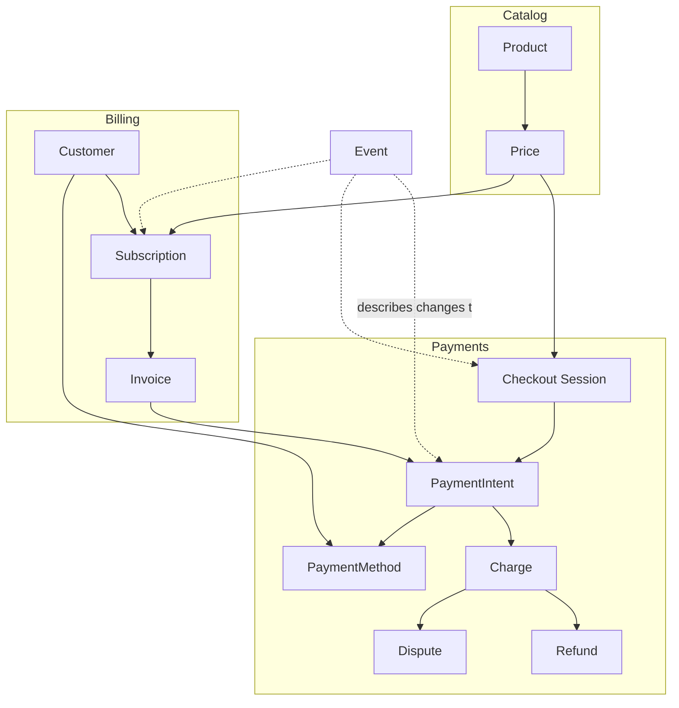

| Object | ID Prefix | Role |
| :--- | :--- | :--- |
| **Customer** | `cus_` | A payer you recognise again: email, saved payment methods, invoices. |
| **Product / Price** | `prod_` / `price_` | What you sell and how much it costs (one-time or recurring). A product has many prices. |
| **PaymentIntent** | `pi_` | One attempt to collect a specific amount, tracked through authentication and capture. The heart of modern Stripe. |
| **PaymentMethod** | `pm_` | A card, bank account or wallet credential, reusable when attached to a customer. |
| **Charge** | `ch_` | The record of an individual money movement created by a PaymentIntent. Refunds and disputes hang off it. |
| **Checkout Session** | `cs_` | A hosted payment page that creates the PaymentIntent (or Subscription) for you. |
| **SetupIntent** | `seti_` | Collects and authenticates a payment method for later use without charging now. |
| **Subscription / Invoice** | `sub_` / `in_` | Recurring billing; each cycle produces an invoice, which produces a PaymentIntent. |
| **Event** | `evt_` | An immutable record that something changed. Delivered to webhooks and retained for listing. |

### 1.4 Money as Integers: Minor Units & Currencies

Stripe amounts are **integers in the currency's smallest unit**. Floating point never appears on the wire, and it should never appear in your pricing code either.

$$\$19.99 \rightarrow 19.99 \times 100 = 1999 \text{ (cents)}$$

| Currency Class | Examples | `unit_amount` for "10" |
| :--- | :--- | :--- |
| Two-decimal (most) | `usd`, `eur`, `gbp`, `inr` | `1000` |
| Zero-decimal | `jpy`, `krw`, `vnd` | `10` |
| Three-decimal | `kwd`, `bhd`, `jod` | `10000` (Stripe may require the last digit to be `0`) |

Each currency also has a minimum chargeable amount (roughly the equivalent of fifty US cents), so a five-cent sticker cannot be sold on its own.

```typescript
// Integer-only money helpers. Keep every calculation in minor units.
const ZERO_DECIMAL = new Set(['jpy', 'krw', 'vnd', 'clp', 'xof', 'xaf']);

export function toMinorUnits(major: string, currency: string): number {
  // Parse from a decimal string, never from a float, to avoid 0.1 + 0.2 bugs.
  const [whole, frac = ''] = major.split('.');
  if (ZERO_DECIMAL.has(currency.toLowerCase())) return Number(whole);
  return Number(whole) * 100 + Number(frac.padEnd(2, '0').slice(0, 2));
}

export function formatMinor(amount: number, currency: string, locale = 'en-US'): string {
  const divisor = ZERO_DECIMAL.has(currency.toLowerCase()) ? 1 : 100;
  return new Intl.NumberFormat(locale, { style: 'currency', currency }).format(amount / divisor);
}

// toMinorUnits('19.99', 'usd') === 1999
// formatMinor(1999, 'usd') === '$19.99'
```

### 1.5 Your First API Calls (curl & Node.js)

Stripe's API is form-encoded over HTTPS with HTTP Basic auth, where the secret key is the username. That makes `curl` the fastest way to build intuition.

```bash
# 1. Export a TEST key from Dashboard > Developers > API keys
export STRIPE_SECRET_KEY=sk_test_...

# 2. Create a customer (nested params use bracket syntax)
curl https://api.stripe.com/v1/customers \
  -u "$STRIPE_SECRET_KEY:" \
  -d email="ada@example.com" \
  -d "metadata[internal_user_id]"=42

# 3. Create a $25.00 PaymentIntent and confirm it with a test card token
curl https://api.stripe.com/v1/payment_intents \
  -u "$STRIPE_SECRET_KEY:" \
  -d amount=2500 \
  -d currency=usd \
  -d payment_method=pm_card_visa \
  -d confirm=true \
  -d "automatic_payment_methods[enabled]"=true \
  -d "automatic_payment_methods[allow_redirects]"=never

# 4. List the five most recent events your account produced
curl -G https://api.stripe.com/v1/events -u "$STRIPE_SECRET_KEY:" -d limit=5
```

The official Node.js SDK wraps the same calls with types, automatic retries and pagination helpers.

```typescript
// first-call.ts: run with `npx tsx --env-file=.env first-call.ts`
import Stripe from 'stripe';

const stripe = new Stripe(process.env.STRIPE_SECRET_KEY!, {
  maxNetworkRetries: 2, // retries idempotent-safe failures with backoff
  timeout: 20_000,
});

async function main() {
  // 1. Create a customer
  const customer = await stripe.customers.create({
    email: 'ada@example.com',
    metadata: { internal_user_id: '42' },
  });

  // 2. Charge a test card server-side (useful for scripts, not for real checkouts)
  const intent = await stripe.paymentIntents.create({
    amount: 2500,
    currency: 'usd',
    customer: customer.id,
    payment_method: 'pm_card_visa',
    confirm: true,
    automatic_payment_methods: { enabled: true, allow_redirects: 'never' },
  });
  console.log(intent.id, intent.status); // pi_..., succeeded

  // 3. Auto-paginate: iterates every page lazily
  for await (const event of stripe.events.list({ limit: 100 })) {
    console.log(event.type);
  }
}

main().catch((err) => {
  console.error(err);
  process.exit(1);
});
```

### 1.6 Errors, Request IDs & API Versioning

Every response carries a `Request-Id` header (`req_...`). Log it on every failure; it is the first thing Stripe support asks for and it links directly to the request in the Dashboard logs.

| Error Class (Node SDK) | `type` | Typical Cause | Correct Reaction |
| :--- | :--- | :--- | :--- |
| `StripeCardError` | `card_error` | Decline, insufficient funds, incorrect CVC | Show a friendly message; let the customer try another method. |
| `StripeInvalidRequestError` | `invalid_request_error` | Bad params, missing object | Bug in your code. Alert, do not retry. |
| `StripeIdempotencyError` | `idempotency_error` | Same key reused with different params | Bug. Keys must map 1:1 to an operation. |
| `StripeRateLimitError` | (HTTP 429) | Too many requests per second | Back off with jitter; the SDK retries automatically. |
| `StripeAPIError` / `StripeConnectionError` | `api_error` | Stripe-side or network failure | Retry with the **same** idempotency key. |
| `StripeAuthenticationError` | (HTTP 401) | Wrong or revoked key | Page someone. |

```typescript
import Stripe from 'stripe';

export async function chargeSafely(stripe: Stripe, params: Stripe.PaymentIntentCreateParams, key: string) {
  try {
    return await stripe.paymentIntents.create(params, { idempotencyKey: key });
  } catch (err) {
    if (err instanceof Stripe.errors.StripeCardError) {
      // decline_code is more specific than code (e.g. "insufficient_funds")
      return { declined: true, code: err.code, declineCode: err.decline_code };
    }
    if (err instanceof Stripe.errors.StripeError) {
      console.error({ type: err.type, requestId: err.requestId, message: err.message });
    }
    throw err;
  }
}
```

**API versioning.** Stripe versions its API by date-stamped release names, and each account has a default version. Breaking changes only reach you when you upgrade. The typed SDKs pin the version they were generated against, so upgrading the `stripe` npm package *is* your API upgrade: read the changelog, run your webhook tests, then roll forward. Webhook endpoints have their own version setting; keep it aligned with the SDK so that event payloads match your types.

---

## 2. Stage 2: Stripe Checkout & Hosted Payment Flows

### 2.1 Choosing an Integration Surface

| Surface | You Build | Stripe Handles | Best For |
| :--- | :--- | :--- | :--- |
| **Payment Links** | Nothing (Dashboard or API) | Page, payment, receipts | Fixed-price items, invoices by email, no-code sellers. |
| **Checkout (hosted)** | A server endpoint that creates a session | Page, wallets, SCA, tax, localisation, address collection | Most web businesses. Fastest path to production. |
| **Checkout (embedded)** | Server endpoint + a mount point on your page | Same as hosted, rendered inside your site | Keeping the customer on your domain. |
| **Payment Element + PaymentIntents** | Server endpoint + your own checkout UI | Payment form, SCA, payment method logic | Fully custom flows, multi-step carts, mobile apps. |

The rule of thumb at staff level: **start with Checkout and move down the table only when a requirement forces you to.** Every step down transfers more edge cases (wallet eligibility, redirect-based methods, error copy, accessibility) from Stripe to your team.

### 2.2 Creating a Checkout Session on the Server

The browser never chooses the amount. It sends an identifier; the server looks up the price, creates the session and returns a URL.

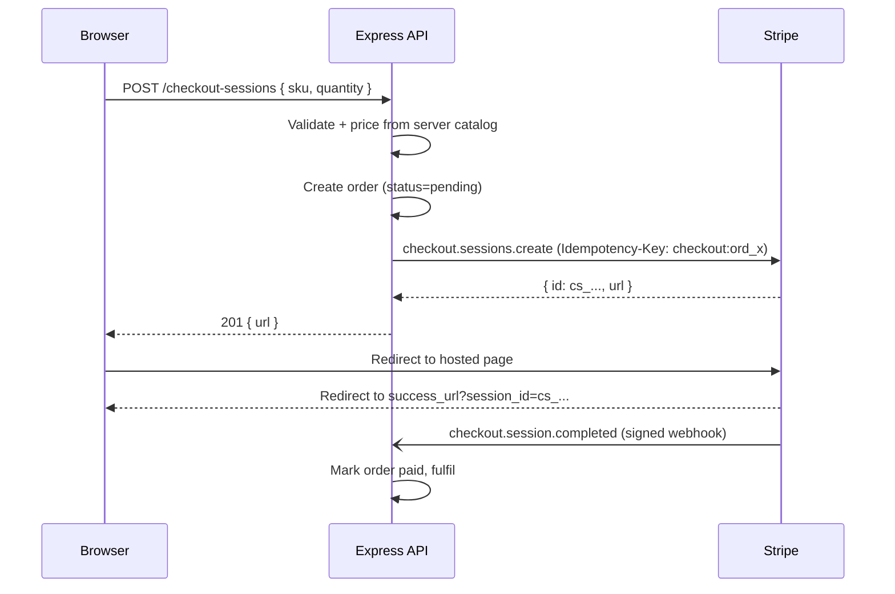

This is the heart of `src/app.ts` in the companion project:

```typescript
app.post('/checkout-sessions', async (req: Request, res: Response) => {
  let priced;
  try {
    priced = priceLineItem(req.body?.sku, req.body?.quantity); // server-side price lookup
  } catch (err) {
    if (err instanceof CatalogError) {
      res.status(400).json({ error: err.message });
      return;
    }
    throw err;
  }

  const order = store.create({
    sku: priced.sku,
    quantity: priced.quantity,
    amount: priced.total,
    currency: priced.item.currency,
  });

  try {
    const session = await checkout.createCheckoutSession(
      {
        mode: 'payment',
        line_items: [{
          quantity: priced.quantity,
          price_data: {
            currency: priced.item.currency,
            unit_amount: priced.item.unitAmount,
            product_data: { name: priced.item.name },
          },
        }],
        client_reference_id: order.id, // ties the session back to OUR order
        metadata: { orderId: order.id, sku: priced.sku },
        success_url: `${publicBaseUrl}/orders/${order.id}?session_id={CHECKOUT_SESSION_ID}`,
        cancel_url: `${publicBaseUrl}/cart`,
      },
      `checkout:${order.id}`, // idempotency key: one session per order, ever
    );
    store.update(order.id, { checkoutSessionId: session.id });
    res.status(201).json({ orderId: order.id, sessionId: session.id, url: session.url });
  } catch (err) {
    res.status(502).json({ error: 'Payment provider unavailable', orderId: order.id });
  }
});
```

Key parameters worth knowing:

1. **`mode`**: `payment` (one-off), `subscription` (recurring) or `setup` (save a method, charge later).
2. **`client_reference_id`**: your own identifier, echoed back on every event for the session. This is how you join Stripe data to your database without a lookup table.
3. **`{CHECKOUT_SESSION_ID}`**: a literal template token. Stripe substitutes the real session ID into the success URL.
4. **`customer` / `customer_email`**: attach a known customer so saved methods and receipts work.
5. **`expires_at`**: sessions expire after 24 hours by default; shorten it for limited inventory and listen for `checkout.session.expired` to release stock.
6. **`payment_intent_data`**: pass-through options for the underlying PaymentIntent (`capture_method`, `metadata`, `setup_future_usage`, Connect fields).

### 2.3 Products, Prices & the Server-Side Catalog

There are two ways to price a line item:

* **`price: 'price_123'`**: reference a `Price` created in the Dashboard or API. Best when finance owns the catalog and you want reporting by product.
* **`price_data: {...}`**: an inline, ad-hoc price. Best for dynamic carts, but the amount still comes from **your** database, never the request.

```typescript
// src/catalog.ts: the browser sends a SKU and a quantity, never an amount
export const CATALOG: Readonly<Record<string, CatalogItem>> = Object.freeze({
  'guide-ebook': { name: 'Stripe Field Guide (eBook)', unitAmount: 1900, currency: 'usd' },
  'workshop-seat': { name: 'Payments Workshop Seat', unitAmount: 14900, currency: 'usd' },
  'sticker-pack': { name: 'Sticker Pack', unitAmount: 500, currency: 'usd' },
});

export function priceLineItem(sku: unknown, quantity: unknown) {
  // Object.hasOwn blocks prototype keys such as "__proto__" or "constructor"
  if (typeof sku !== 'string' || !Object.hasOwn(CATALOG, sku)) {
    throw new CatalogError('Unknown SKU');
  }
  if (typeof quantity !== 'number' || !Number.isInteger(quantity) || quantity < 1 || quantity > MAX_QUANTITY) {
    throw new CatalogError(`Quantity must be an integer between 1 and ${MAX_QUANTITY}`);
  }
  const item = CATALOG[sku] as CatalogItem;
  return { sku, quantity, item, total: item.unitAmount * quantity };
}
```

Prices are **immutable** once used: you cannot edit an amount, only create a new price and archive the old one. Use `lookup_key` on prices so code can refer to `pro_monthly` instead of hard-coding `price_...` IDs that differ between test and live mode.

```typescript
// Resolve prices by stable lookup keys rather than environment-specific IDs
const { data } = await stripe.prices.list({ lookup_keys: ['pro_monthly', 'pro_yearly'], active: true });
const byKey = Object.fromEntries(data.map((p) => [p.lookup_key, p.id]));
```

### 2.4 Success Pages Are Not Proof of Payment

A customer can close the tab before the redirect, lose connectivity, or simply type the success URL by hand. Conversely, a bank debit can reach the success page and fail three days later. The success page must therefore **read state**, not **write it**:

```
WRONG                                   RIGHT
-----                                   -----
GET /success?session_id=cs_...          GET /orders/:id
  -> mark order paid                      -> return order.status from the DB
  -> send ebook                           (only the webhook handler writes "paid"
                                           and triggers fulfillment)
```

If you want the success page to show an accurate answer before the webhook lands, retrieve the session server-side (`stripe.checkout.sessions.retrieve(id)`) and display `payment_status`, but still let the webhook be the single writer. Some teams also call the same idempotent fulfillment function from both paths; that is acceptable only if the function is genuinely idempotent (see Stage 4).

### 2.5 Idempotency Keys & Safe Retries

Networks fail between "Stripe created the object" and "your server received the response". Without protection, the retry creates a second PaymentIntent or a second refund. Idempotency keys make a POST safe to repeat.

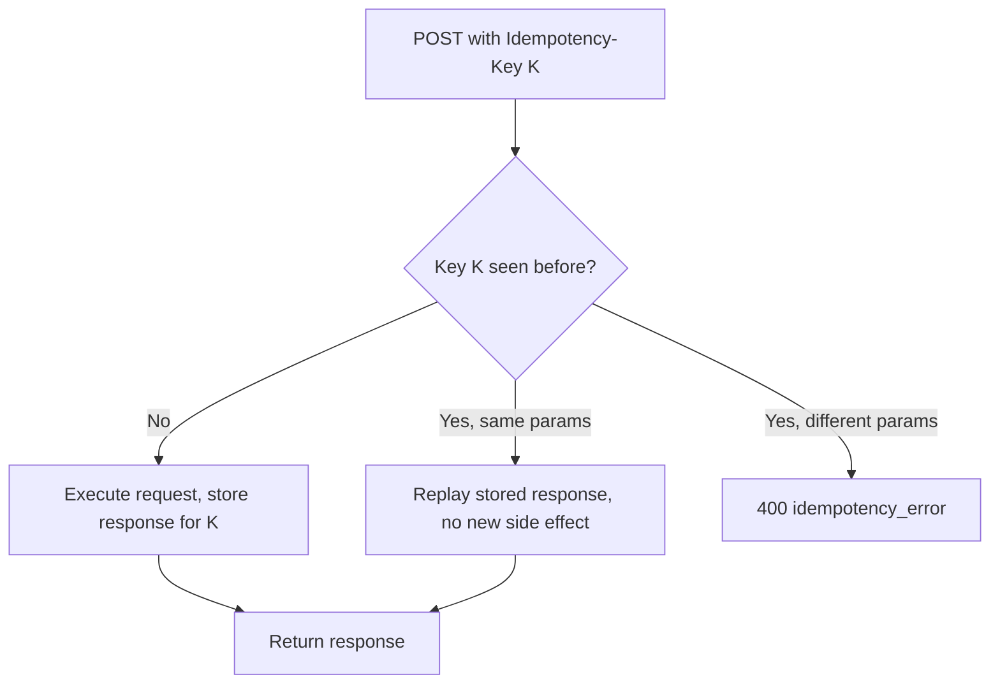

1. **Derive keys from your domain**, not from random UUIDs generated per attempt: `checkout:${orderId}`, `refund:${refundRequestId}`. A per-attempt UUID protects nothing.
2. **Reuse the same key on every retry** of the same logical operation, including retries after a process restart.
3. **Keys are remembered for at least 24 hours.** For longer-lived protection, also enforce uniqueness in your own database.
4. **The SDK's `maxNetworkRetries`** automatically adds an idempotency key to retried POSTs, but only within a single call. Your own key covers retries across calls and processes.

### 2.6 Embedded Checkout, Payment Links & Customisation

Embedded Checkout keeps the same server-side session but renders it inside your page. Create the session with the embedded UI mode and return its `client_secret` instead of a URL; the client mounts it with Stripe.js.

```typescript
// Server: embedded mode returns a client_secret instead of a redirect URL
const session = await stripe.checkout.sessions.create({
  ui_mode: 'embedded',
  mode: 'payment',
  line_items: [{ price: priceId, quantity: 1 }],
  return_url: `${baseUrl}/orders/${orderId}?session_id={CHECKOUT_SESSION_ID}`,
  client_reference_id: orderId,
});
res.json({ clientSecret: session.client_secret });
```

```typescript
// Browser: mount Checkout inside a <div id="checkout"></div>
import { loadStripe } from '@stripe/stripe-js';

const stripe = await loadStripe('pk_test_...');
const { clientSecret } = await fetch('/checkout-sessions/embedded', { method: 'POST' }).then((r) => r.json());
const checkout = await stripe!.initEmbeddedCheckout({ fetchClientSecret: async () => clientSecret });
checkout.mount('#checkout');
```

Other high-leverage Checkout options: `automatic_tax: { enabled: true }` with Stripe Tax, `allow_promotion_codes: true`, `shipping_address_collection`, `phone_number_collection`, `consent_collection` for terms acceptance, `locale`, and custom branding from Dashboard settings. Payment Links are the zero-code sibling: create one in the Dashboard or with `stripe.paymentLinks.create({ line_items })`, and handle fulfillment from the same `checkout.session.completed` webhook.

---

## 3. Stage 3: Payment Intents, SCA & Custom Payment Flows

When you need your own checkout UI, you work directly with the **PaymentIntent**: a server-created object representing "collect this amount from this customer", which the client confirms with payment details.

### 3.1 The PaymentIntent State Machine

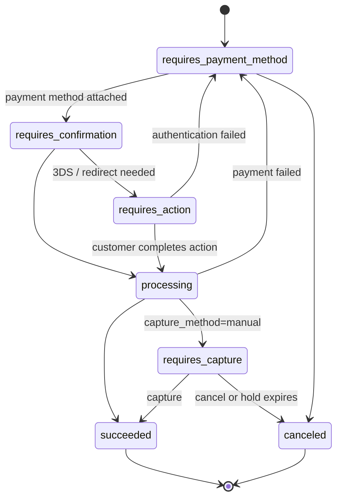

| Status | Meaning | Your Move |
| :--- | :--- | :--- |
| `requires_payment_method` | No method yet, or the last attempt failed | Show the form again. |
| `requires_confirmation` | Method attached, not yet confirmed | Confirm (usually the client does this). |
| `requires_action` | Customer must authenticate (3DS, bank redirect) | Stripe.js handles it; your UI waits. |
| `processing` | Submitted; outcome pending (common for bank debits) | Wait for a webhook. Do not fulfil. |
| `requires_capture` | Authorised, funds held | Capture within the hold window, or cancel. |
| `succeeded` | Funds captured | Fulfil (from the webhook). |
| `canceled` | Abandoned or voided | Release inventory. |

A failed attempt sends the intent **back** to `requires_payment_method` rather than to a terminal failed state. One PaymentIntent therefore represents the whole purchase, however many cards the customer tries, which is what makes it safe to reuse per order.

### 3.2 Server: Creating a PaymentIntent

```typescript
// routes/payment-intents.ts
import type { Request, Response } from 'express';
import type Stripe from 'stripe';

export function createPaymentIntentRoute(stripe: Stripe, orders: OrdersRepo) {
  return async (req: Request, res: Response) => {
    const order = await orders.getForUser(req.body.orderId, req.user.id);
    if (!order) return res.status(404).end();

    // 1. Reuse the intent if this order already has one (one intent per order)
    if (order.paymentIntentId) {
      const existing = await stripe.paymentIntents.retrieve(order.paymentIntentId);
      return res.json({ clientSecret: existing.client_secret });
    }

    // 2. Create with an amount computed on the server and a domain-derived idempotency key
    const intent = await stripe.paymentIntents.create(
      {
        amount: order.totalMinor,
        currency: order.currency,
        customer: order.stripeCustomerId,
        automatic_payment_methods: { enabled: true }, // let Dashboard settings decide methods
        metadata: { orderId: order.id },
        receipt_email: order.email,
      },
      { idempotencyKey: `pi:${order.id}` },
    );

    await orders.attachPaymentIntent(order.id, intent.id);
    // 3. Only the client_secret goes to the browser, never the secret key
    res.json({ clientSecret: intent.client_secret });
  };
}
```

If the cart changes before payment, update the existing intent with `stripe.paymentIntents.update(id, { amount })` instead of creating a new one.

### 3.3 Client: The Payment Element

The Payment Element is a single prebuilt UI component that renders every payment method enabled for the account (cards, wallets, bank debits, local methods) and handles SCA flows.

```typescript
// checkout.ts (browser)
import { loadStripe } from '@stripe/stripe-js';

const stripe = (await loadStripe(import.meta.env.VITE_STRIPE_PUBLISHABLE_KEY))!;

// 1. Ask the server for a client_secret bound to this order
const { clientSecret } = await fetch('/payment-intents', {
  method: 'POST',
  headers: { 'Content-Type': 'application/json' },
  body: JSON.stringify({ orderId }),
}).then((r) => r.json());

// 2. Mount the Payment Element
const elements = stripe.elements({ clientSecret, appearance: { theme: 'stripe' } });
elements.create('payment', { layout: 'tabs' }).mount('#payment-element');

// 3. Confirm on submit; Stripe.js runs 3DS or redirects as needed
document.querySelector('#pay-form')!.addEventListener('submit', async (e) => {
  e.preventDefault();
  const { error } = await stripe.confirmPayment({
    elements,
    confirmParams: { return_url: `${location.origin}/orders/${orderId}` },
  });
  // Only immediate errors land here (validation, declines). Success redirects away.
  if (error) showError(error.message ?? 'Payment failed');
});
```

After a redirect, Stripe appends `payment_intent` and `payment_intent_client_secret` to the `return_url`. Use `stripe.retrievePaymentIntent(clientSecret)` to render the status, and still fulfil only from the webhook.

### 3.4 Strong Customer Authentication & 3D Secure

European (PSD2) and several other regulations require **Strong Customer Authentication** for many online card payments: two of knowledge, possession and inherence. On cards this is implemented as **3D Secure**, where the issuer may challenge the customer with an app prompt or a one-time code.

1. **On-session payments**: Stripe.js handles the challenge automatically when the intent moves to `requires_action`. Your code does nothing extra beyond using `confirmPayment`.
2. **Exemptions**: low-value, low-risk and merchant-initiated transactions may be exempt; Stripe requests exemptions where it can, but the **issuer** decides.
3. **Liability shift**: a successfully authenticated 3DS payment usually shifts fraud-dispute liability to the issuer.
4. **Off-session payments** (renewals, usage charges) cannot show a challenge. If the issuer insists, the charge fails with `authentication_required` and you must bring the customer back on-session (Stage 3.6).

Test with `4000 0025 0000 3155`, which requires authentication on every on-session payment in test mode.

### 3.5 Authorise Now, Capture Later

Marketplaces, hotels and made-to-order shops often need to hold funds and settle the final amount later.

```typescript
// 1. Authorise only: funds are held, nothing is captured
const intent = await stripe.paymentIntents.create(
  {
    amount: 12_000, // maximum you might charge
    currency: 'usd',
    customer: customerId,
    payment_method: paymentMethodId,
    capture_method: 'manual',
    confirm: true,
    automatic_payment_methods: { enabled: true, allow_redirects: 'never' },
  },
  { idempotencyKey: `auth:${bookingId}` },
);
// intent.status === 'requires_capture'

// 2a. Capture the final amount (may be less than authorised, never more)
await stripe.paymentIntents.capture(intent.id, { amount_to_capture: 9_850 }, { idempotencyKey: `capture:${bookingId}` });

// 2b. Or release the hold entirely
await stripe.paymentIntents.cancel(intent.id, { cancellation_reason: 'abandoned' });
```

Card authorisations expire. For most online card payments the window is about seven days; after that Stripe cancels the intent and the hold disappears. Build a scheduled job that captures or cancels well before expiry, and listen for `payment_intent.canceled` as a safety net.

### 3.6 SetupIntents & Off-Session Charges

A **SetupIntent** collects and authenticates a payment method *now* so you can charge it *later* without the customer present: free trials, usage billing, post-paid rides.

```typescript
// 1. On-session: create a SetupIntent and confirm it with the Payment Element (stripe.confirmSetup)
const setupIntent = await stripe.setupIntents.create({
  customer: customerId,
  usage: 'off_session', // tells issuers you will charge without the customer present
  automatic_payment_methods: { enabled: true },
});
// send setupIntent.client_secret to the browser

// 2. Later, off-session: charge the saved method
export async function chargeSaved(stripe: Stripe, customerId: string, pmId: string, amount: number, key: string) {
  try {
    return await stripe.paymentIntents.create(
      { amount, currency: 'usd', customer: customerId, payment_method: pmId, off_session: true, confirm: true },
      { idempotencyKey: key },
    );
  } catch (err) {
    if (err instanceof Stripe.errors.StripeCardError && err.code === 'authentication_required') {
      // 3. The issuer wants 3DS: email the customer a link back to an on-session page
      //    that confirms err.payment_intent with the Payment Element.
      return { needsCustomer: true, paymentIntentId: err.payment_intent?.id };
    }
    throw err;
  }
}
```

During a one-off purchase you can achieve the same by passing `setup_future_usage: 'off_session'` on the PaymentIntent (or `payment_intent_data.setup_future_usage` on a Checkout Session), which saves the method while charging it.

---

## 4. Stage 4: Webhooks, Signatures & Event-Driven Fulfillment

### 4.1 Why Webhooks Are the Source of Truth

A webhook is an HTTPS POST that Stripe sends to your endpoint whenever an `Event` is created. Payments are asynchronous by nature (bank debits settle in days, disputes arrive weeks later, subscriptions renew at 3 a.m.), so the only reliable way to learn the outcome is to **let Stripe tell you**.

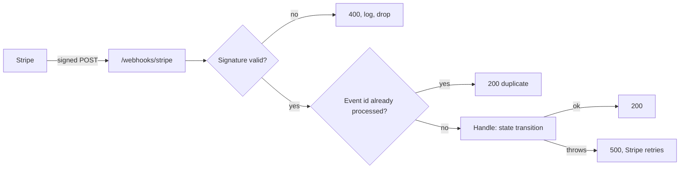

Events your fulfillment should almost always subscribe to:

| Flow | Events |
| :--- | :--- |
| Checkout (payment) | `checkout.session.completed`, `checkout.session.async_payment_succeeded`, `checkout.session.async_payment_failed`, `checkout.session.expired` |
| Custom PaymentIntents | `payment_intent.succeeded`, `payment_intent.payment_failed`, `payment_intent.processing`, `payment_intent.canceled`, `payment_intent.amount_capturable_updated` |
| Subscriptions | `customer.subscription.created/updated/deleted`, `invoice.paid`, `invoice.payment_failed`, `invoice.payment_action_required`, `customer.subscription.trial_will_end` |
| Money backwards | `charge.refunded`, `refund.updated`, `charge.dispute.created`, `charge.dispute.closed` |
| Connect | `account.updated`, `payout.failed`, `account.application.deauthorized` |

Subscribe each endpoint to **only** the events it handles. Fewer events means less load, smaller blast radius and clearer logs.

### 4.2 Anatomy of the Stripe-Signature Header

Anyone on the internet can POST JSON to your endpoint, so every delivery is signed with the endpoint's `whsec_` secret.

```
Stripe-Signature: t=1793481600,v1=6ffbb59b2300aae63f2723...,v1=9c1f2e...
                  |            |
                  |            +-- HMAC-SHA256(secret, "<t>.<raw body>") as hex
                  |                (several v1 values appear during secret rotation)
                  +-- Unix timestamp when Stripe signed the payload
```

Verification, step by step:

1. Split the header into `t` and every `v1` value (ignore other schemes).
2. Build the signed payload: the timestamp, a literal `.`, then the **exact raw request bytes**.
3. Compute HMAC-SHA256 with the endpoint secret and compare to each `v1` with a **constant-time** comparison.
4. Reject if the timestamp is older than your tolerance (the SDK default is 300 seconds) to block replays.

The SDK does all of this in one call. Writing it by hand is a good exercise for understanding, and a bad idea for production:

```typescript
// Educational only: what stripe.webhooks.constructEvent does under the hood
import { createHmac, timingSafeEqual } from 'node:crypto';

export function verifyStripeSignature(raw: Buffer, header: string, secret: string, toleranceSec = 300): boolean {
  const parts = header.split(',').map((kv) => kv.split('=') as [string, string]);
  const t = Number(parts.find(([k]) => k === 't')?.[1]);
  const signatures = parts.filter(([k]) => k === 'v1').map(([, v]) => v);
  if (!Number.isFinite(t) || signatures.length === 0) return false;
  if (Math.abs(Date.now() / 1000 - t) > toleranceSec) return false; // replay window

  const expected = createHmac('sha256', secret).update(`${t}.`).update(raw).digest();
  return signatures.some((sig) => {
    const given = Buffer.from(sig, 'hex');
    return given.length === expected.length && timingSafeEqual(given, expected);
  });
}
```

The companion project wraps the SDK call behind a small interface so tests can use real signatures without the network:

```typescript
// src/payments.ts
export function stripeWebhookVerifier(stripe: Stripe, endpointSecret: string, toleranceSeconds = 300): WebhookVerifier {
  return {
    verify(rawBody, signatureHeader) {
      return stripe.webhooks.constructEvent(rawBody, signatureHeader, endpointSecret, toleranceSeconds);
    },
  };
}
```

### 4.3 Raw Bodies in Express

The most common webhook bug in Node.js: a global `express.json()` parses the body before your handler sees it. Re-serialising that object changes whitespace and key order, the HMAC no longer matches, and every event fails with "No signatures found matching the expected signature".

```
BROKEN                                       FIXED
------                                       -----
app.use(express.json());                     app.post('/webhooks/stripe',
app.post('/webhooks/stripe', handler);         express.raw({ type: 'application/json' }),
// req.body is an object, bytes are gone        handler);              // req.body is a Buffer
                                             app.use(express.json());   // everything else
```

```typescript
// src/app.ts (excerpt): webhook route registered BEFORE the JSON parser
app.post(
  '/webhooks/stripe',
  express.raw({ type: 'application/json', limit: '1mb' }),
  (req: Request, res: Response) => {
    const signature = req.header('stripe-signature');
    if (!signature || !Buffer.isBuffer(req.body)) {
      res.status(400).json({ error: 'Missing Stripe-Signature header or body' });
      return;
    }

    let event;
    try {
      event = webhooks.verify(req.body, signature);
    } catch (err) {
      res.status(400).json({ error: 'Invalid signature' });
      return;
    }

    if (!store.claimEvent(event.id)) {
      res.status(200).json({ received: true, duplicate: true });
      return;
    }

    try {
      const result = handleStripeEvent(event, store);
      res.status(200).json({ received: true, result });
    } catch (err) {
      store.releaseEvent(event.id); // let Stripe's retry try again
      res.status(500).json({ error: 'Handler failed' });
    }
  },
);

app.use(express.json({ limit: '16kb' }));
```

The same trap exists elsewhere: in Next.js route handlers read `await req.text()`; in Fastify register a raw-body content-type parser for the route; behind API gateways make sure nothing base64-decodes, pretty-prints or re-encodes the payload.

### 4.4 Idempotent, Order-Independent Handlers

Stripe guarantees **at-least-once** delivery and **does not guarantee ordering**. Design for both:

1. **Deduplicate on `event.id`.** In production, insert the id into a `processed_events` table with a unique constraint inside the same transaction as the state change. A unique-violation means "already done".
2. **Make transitions monotonic.** A late `checkout.session.expired` must never overwrite `paid`; a `payment_intent.processing` arriving after `succeeded` must be ignored.
3. **Prefer re-fetching for complex objects.** When order matters (subscriptions), treat the event as a nudge and `retrieve` the current object from the API before deciding.
4. **Return 2xx for events you do not care about**, or Stripe will keep retrying them.

```typescript
// src/fulfillment.ts (excerpt): monotonic, replay-safe transitions
case 'checkout.session.completed': {
  const session = event.data.object;
  const orderId = session.client_reference_id ?? session.metadata?.orderId;
  if (!orderId || !store.get(orderId)) return 'ignored';
  // Cards report 'paid' immediately; bank debits report 'unpaid' and settle later
  const status = session.payment_status === 'unpaid' ? 'awaiting_payment' : 'paid';
  store.update(orderId, { status, paymentIntentId: idOf(session.payment_intent) });
  return 'handled';
}
case 'checkout.session.expired': {
  const order = store.get(orderIdFrom(event.data.object) ?? '');
  if (!order || order.status !== 'pending') return 'ignored'; // never downgrade a paid order
  store.update(order.id, { status: 'expired' });
  return 'handled';
}
```

A production-grade version of the dedupe step in SQL:

```sql
-- One row per Stripe event; the primary key is the idempotency guard
CREATE TABLE processed_stripe_events (
  event_id     TEXT PRIMARY KEY,
  event_type   TEXT NOT NULL,
  received_at  TIMESTAMPTZ NOT NULL DEFAULT now()
);

-- Inside the handler transaction:
-- INSERT INTO processed_stripe_events (event_id, event_type) VALUES ($1, $2)
--   ON CONFLICT (event_id) DO NOTHING RETURNING event_id;
-- No row returned => duplicate, commit and return 200 without side effects.
```

### 4.5 Retries, Queues & Backpressure

Stripe expects a fast 2xx. If your endpoint times out or returns a non-2xx status, Stripe retries with exponential backoff for up to three days in live mode (fewer, shorter retries in test mode) and eventually emails you about a failing endpoint.

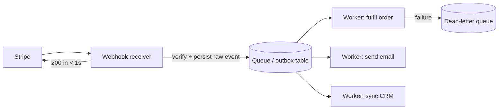

1. **Verify, persist, acknowledge.** The receiver does the minimum synchronously, then hands work to a queue (SQS, Pub/Sub, BullMQ, a Postgres outbox).
2. **Workers are idempotent too**, because queues also deliver at least once.
3. **Recovery after an outage**: list missed events with `stripe.events.list({ created: { gte: outageStart }, type: 'checkout.session.completed' })` and feed them through the same handler. Event objects are retained for roughly 30 days.
4. **Secret rotation**: rolling an endpoint secret in the Dashboard can keep the old secret valid for a grace period, during which deliveries carry two `v1` signatures. Deploy the new secret before the grace period ends.

### 4.6 Local Development with the Stripe CLI

The Stripe CLI forwards test-mode events to `localhost` and signs them with a temporary `whsec_` secret.

```bash
# 1. Authenticate the CLI against your test account (opens a browser)
stripe login

# 2. Forward events to the local server; copy the printed whsec_ into .env
stripe listen --forward-to localhost:4242/webhooks/stripe \
  --events checkout.session.completed,checkout.session.expired,checkout.session.async_payment_succeeded,checkout.session.async_payment_failed,charge.refunded

# 3. In another terminal, run the service
npm run dev

# 4. Fire synthetic events (these create real test-mode objects)
stripe trigger checkout.session.completed
stripe trigger charge.refunded

# 5. Replay a specific event and tail API request logs
stripe events resend evt_1Q...
stripe logs tail
```

For automated tests you do not need the CLI at all. `stripe.webhooks.generateTestHeaderString({ payload, secret })` produces a valid header for any fixture payload, which is exactly how `tests/app.test.ts` exercises valid, tampered, wrong-secret and replayed deliveries.

```typescript
// tests/app.test.ts (excerpt): real signatures over fixture events, fully offline
const payload = JSON.stringify(eventFixture('checkout.session.completed', checkoutSessionObject(orderId)));
const header = stripe.webhooks.generateTestHeaderString({ payload, secret: WEBHOOK_SECRET });

const res = await request(app)
  .post('/webhooks/stripe')
  .set('Content-Type', 'application/json')
  .set('Stripe-Signature', header)
  .send(payload);

assert.equal(res.status, 200);
assert.equal(store.get(orderId)!.status, 'paid');
```

---

## 5. Stage 5: Subscriptions, Billing, Refunds & Disputes

### 5.1 Recurring Prices & Subscription Checkout

A subscription is a customer plus one or more recurring prices. Each billing period Stripe generates an **invoice**, finalises it, and attempts payment through a PaymentIntent.

```typescript
// 1. One product, two recurring prices addressed by lookup keys
const product = await stripe.products.create({ name: 'Learning Hub Pro' });
await stripe.prices.create({
  product: product.id,
  currency: 'usd',
  unit_amount: 1200,
  recurring: { interval: 'month' },
  lookup_key: 'pro_monthly',
});
await stripe.prices.create({
  product: product.id,
  currency: 'usd',
  unit_amount: 12000,
  recurring: { interval: 'year' },
  lookup_key: 'pro_yearly',
});

// 2. Start a subscription through Checkout, with a 14-day trial
const session = await stripe.checkout.sessions.create({
  mode: 'subscription',
  customer: customerId, // reuse the customer so one person never has two subscriptions
  line_items: [{ price: proMonthlyPriceId, quantity: 1 }],
  subscription_data: { trial_period_days: 14, metadata: { userId } },
  success_url: `${baseUrl}/account?session_id={CHECKOUT_SESSION_ID}`,
  cancel_url: `${baseUrl}/pricing`,
});
```

Pricing models that map to `Price` configuration: flat rate, per-seat (`quantity`), tiered (`billing_scheme: 'tiered'` with volume or graduated tiers) and usage-based billing, where you report usage to a **billing meter** and Stripe aggregates it into the invoice.

### 5.2 The Subscription Lifecycle

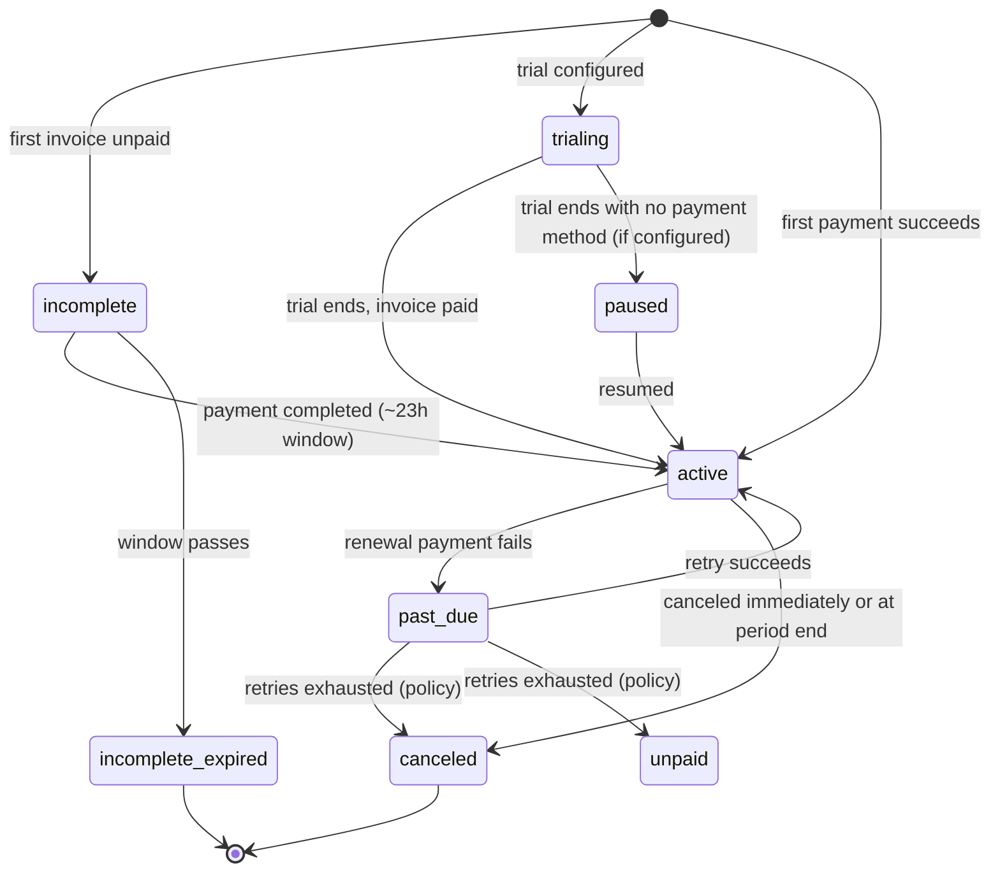

Map these statuses to **entitlements** in your own database rather than checking Stripe on every request:

| Status | Grant Access? | Notes |
| :--- | :--- | :--- |
| `trialing`, `active` | Yes | Normal paying (or trial) state. |
| `past_due` | Usually yes, with a banner | Dunning in progress; give a grace period. |
| `incomplete` | No | Initial payment needs action (e.g. 3DS). |
| `unpaid`, `canceled`, `incomplete_expired` | No | Terminal or suspended. |
| `paused` | No | Resume with `stripe.subscriptions.resume`. |

```typescript
// Webhook handler: keep entitlements in sync, re-fetching to defeat out-of-order delivery
case 'customer.subscription.created':
case 'customer.subscription.updated':
case 'customer.subscription.deleted': {
  const fresh = await stripe.subscriptions.retrieve(event.data.object.id);
  const active = ['trialing', 'active', 'past_due'].includes(fresh.status);
  await entitlements.upsert({
    userId: fresh.metadata.userId,
    subscriptionId: fresh.id,
    status: fresh.status,
    plan: fresh.items.data[0]?.price.lookup_key ?? 'unknown',
    access: active,
  });
  break;
}
```

### 5.3 Invoices, Dunning & the Customer Portal

1. **`invoice.paid`** is the canonical "extend access for another period" signal. Prefer it to `invoice.payment_succeeded` for entitlement logic because it also fires when an invoice is marked paid out of band.
2. **`invoice.payment_failed`** starts dunning. Stripe's **Smart Retries** re-attempt the payment on days most likely to succeed; configure the schedule and the end state (cancel, mark unpaid, leave past due) in Billing settings.
3. **`invoice.payment_action_required`** means the renewal needs 3DS. Email the customer the hosted invoice URL (`invoice.hosted_invoice_url`).
4. **`customer.subscription.trial_will_end`** fires a few days before a trial converts. Remind the customer, especially if no payment method is on file.

The **Customer Portal** is a Stripe-hosted page where customers update cards, download invoices, switch plans and cancel, configured from the Dashboard.

```typescript
// One endpoint gives customers full self-service billing
app.post('/billing/portal', requireUser, async (req, res) => {
  const portal = await stripe.billingPortal.sessions.create({
    customer: req.user.stripeCustomerId,
    return_url: `${baseUrl}/account`,
  });
  res.redirect(303, portal.url);
});
```

### 5.4 Upgrades, Downgrades & Proration

When a customer switches plans mid-cycle, Stripe can **prorate**: credit unused time on the old price and charge for the remaining time on the new one.

$$\text{proration} \approx (P_{new} - P_{old}) \times \frac{\text{seconds remaining}}{\text{seconds in period}}$$

Upgrading from \$12 to \$30 a month exactly halfway through the period yields roughly $(30 - 12) \times 0.5 = \$9.00$ on the next invoice (or immediately, with `proration_behavior: 'always_invoice'`).

```typescript
// 1. Preview the next invoice before committing, so the UI can show the exact amount
const preview = await stripe.invoices.createPreview({
  customer: customerId,
  subscription: subscriptionId,
  subscription_details: {
    items: [{ id: subscriptionItemId, price: newPriceId }],
    proration_behavior: 'create_prorations',
  },
});
console.log('Due on next invoice:', preview.amount_due);

// 2. Apply the change
await stripe.subscriptions.update(subscriptionId, {
  items: [{ id: subscriptionItemId, price: newPriceId }],
  proration_behavior: 'create_prorations', // or 'always_invoice' / 'none'
});

// 3. Downgrades often wait for the period end; cancellations too
await stripe.subscriptions.update(subscriptionId, { cancel_at_period_end: true });
```

For changes scheduled in the future ("switch to annual at renewal"), use **Subscription Schedules**, which hold an ordered list of phases.

### 5.5 Refunds: Full, Partial & Asynchronous

```typescript
// Refund service: idempotent per refund request, partial by default
export async function refundOrder(stripe: Stripe, order: PaidOrder, amount: number, requestId: string) {
  if (amount <= 0 || amount > order.amount - (order.amountRefunded ?? 0)) {
    throw new Error('Refund exceeds refundable balance');
  }
  const refund = await stripe.refunds.create(
    {
      payment_intent: order.paymentIntentId,
      amount, // omit for a full refund
      reason: 'requested_by_customer', // or 'duplicate' / 'fraudulent'
      metadata: { orderId: order.id, refundRequestId: requestId },
    },
    { idempotencyKey: `refund:${requestId}` },
  );
  return refund.status; // 'pending' | 'succeeded' | 'failed' | 'requires_action' | 'canceled'
}
```

1. **Refunds are asynchronous.** Card refunds usually succeed quickly but take days to appear on the statement; some methods stay `pending` or later move to `failed`. Listen to `charge.refunded` and `refund.updated` rather than trusting the create response.
2. **Track cumulative amounts.** `charge.amount_refunded` is the running total; `charge.refunded` becomes `true` only when fully refunded. The companion service keeps the order `paid` after a partial refund and flips it to `refunded` on a full refund.
3. **Fees.** Processing fees are generally not returned on refunds. Check current pricing for your account rather than assuming.
4. **Refund versus cancel.** If an intent is still `requires_capture`, cancel it instead: releasing a hold costs nothing and never appears as a refund.

### 5.6 Disputes & Chargebacks

A **dispute** happens when a cardholder asks their issuer to reverse a payment. Stripe immediately debits the disputed amount plus a dispute fee from your balance and opens a case with an evidence deadline.

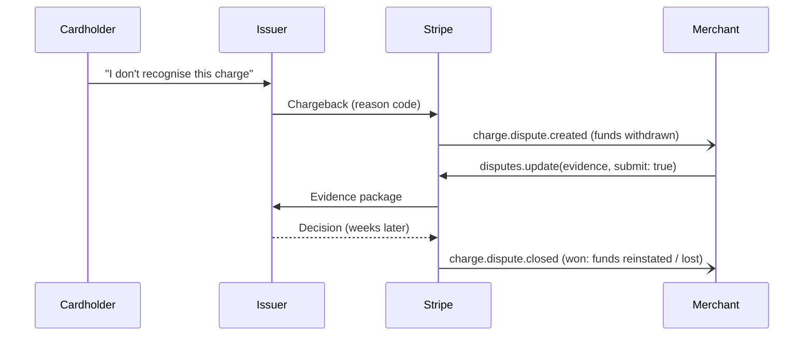

```typescript
// Submit evidence collected automatically from your systems
await stripe.disputes.update(disputeId, {
  evidence: {
    customer_email_address: order.email,
    customer_purchase_ip: order.ip,
    product_description: 'Digital eBook, delivered instantly by download link',
    access_activity_log: await downloads.logFor(order.id), // proves usage
    receipt: receiptFileId, // uploaded earlier via stripe.files.create
  },
  submit: true, // without this the evidence is saved as a draft
});
```

Prevention beats evidence: a recognisable statement descriptor, clear receipts, easy refunds, Radar rules and 3DS on risky payments all lower dispute rates. Card networks run monitoring programs that penalise merchants whose dispute ratio climbs too high, so watch that metric like an SLO.

---

## 6. Stage 6: Connect, Test-Mode Workflows & Production Operations

### 6.1 Connect Architecture & Charge Types

**Connect** lets a platform move money on behalf of other businesses: marketplaces, SaaS platforms that take payments for their customers, gig apps that pay workers. The platform owns the integration; each seller is a **connected account** (`acct_...`).

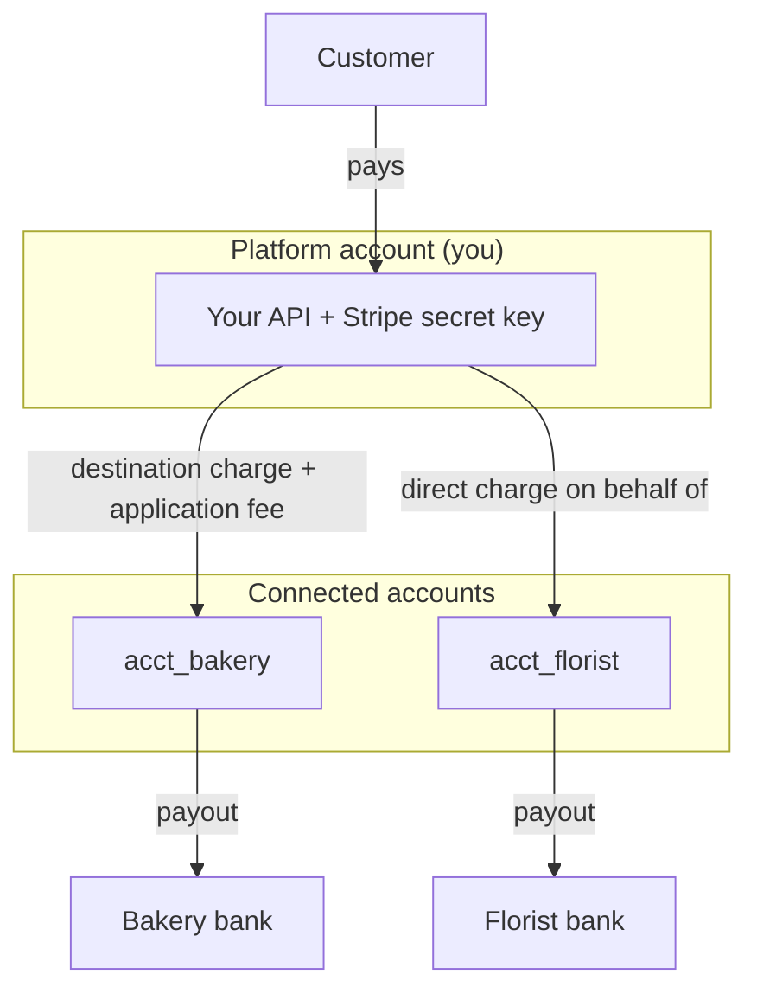

| Charge Type | Who the Charge Belongs To | Fees, Refunds & Disputes | Typical Use |
| :--- | :--- | :--- | :--- |
| **Direct charge** | The connected account (`stripeAccount` request option) | Connected account bears them; platform takes `application_fee_amount` | SaaS platforms where sellers are the merchant of record. |
| **Destination charge** | The platform, auto-transferred to one account (`transfer_data.destination`) | Platform bears them by default | Marketplaces with one seller per order. |
| **Separate charges & transfers** | The platform, transferred later with `transfers.create` | Platform bears them | Multi-seller carts, delayed payouts, splitting one payment. |

```typescript
// Destination charge through Checkout: platform keeps 10% as its fee
const total = 10_000; // $100.00
const session = await stripe.checkout.sessions.create({
  mode: 'payment',
  line_items: [{ price_data: { currency: 'usd', unit_amount: total, product_data: { name: 'Wedding bouquet' } }, quantity: 1 }],
  payment_intent_data: {
    application_fee_amount: Math.round(total * 0.1), // 1000 cents to the platform
    transfer_data: { destination: 'acct_florist123' },
  },
  success_url: `${baseUrl}/orders/${orderId}`,
  cancel_url: `${baseUrl}/cart`,
});

// Direct charge: the same API, executed AS the connected account
await stripe.paymentIntents.create(
  { amount: total, currency: 'usd', application_fee_amount: 1000, automatic_payment_methods: { enabled: true } },
  { stripeAccount: 'acct_bakery456' },
);

// Separate charges & transfers: split one payment across two sellers later
await stripe.transfers.create({ amount: 6000, currency: 'usd', destination: 'acct_bakery456', transfer_group: `order_${orderId}` });
await stripe.transfers.create({ amount: 3000, currency: 'usd', destination: 'acct_florist123', transfer_group: `order_${orderId}` });
```

With a 10% fee on a \$100 order: $10000 \times 0.10 = 1000$ cents for the platform and $9000$ cents for the seller, before Stripe's processing fee, which is deducted from whichever account owns the charge.

### 6.2 Onboarding Connected Accounts

Connected accounts must pass identity verification (KYC) before they can accept charges or receive payouts. Stripe now configures accounts by **controller properties** (who pays fees, who covers losses, which dashboard the account gets, who collects requirements) instead of only the older Standard / Express / Custom labels.

```typescript
// 1. Create an account where the platform pays fees and covers losses, with an Express-style dashboard
const account = await stripe.accounts.create({
  controller: {
    fees: { payer: 'application' },
    losses: { payments: 'application' },
    stripe_dashboard: { type: 'express' },
  },
  capabilities: { card_payments: { requested: true }, transfers: { requested: true } },
  metadata: { sellerId },
});

// 2. Send the seller through Stripe-hosted onboarding
const link = await stripe.accountLinks.create({
  account: account.id,
  type: 'account_onboarding',
  refresh_url: `${baseUrl}/sellers/onboarding/refresh`, // link expired or reused: mint a new one
  return_url: `${baseUrl}/sellers/onboarding/done`, // NOT proof that onboarding finished
});
res.redirect(303, link.url);
```

```typescript
// 3. A Connect webhook endpoint (events from connected accounts carry event.account)
case 'account.updated': {
  const acct = event.data.object;
  await sellers.update(acct.metadata?.sellerId, {
    chargesEnabled: acct.charges_enabled,
    payoutsEnabled: acct.payouts_enabled,
    requirementsDue: acct.requirements?.currently_due ?? [],
  });
  break;
}
```

Gate checkout for a seller on `charges_enabled`, and keep watching `requirements.currently_due`: verification requirements can reappear months later when volumes grow or regulations change.

### 6.3 Test Mode, Sandboxes & Test Cards

Test mode behaves like production without moving money. Use sandboxes to give each developer or CI run an isolated account, so test data stays clean and webhook endpoints do not collide.

| Card Number | Behaviour in Test Mode |
| :--- | :--- |
| `4242 4242 4242 4242` | Succeeds. Any future expiry, any CVC, any postcode. |
| `4000 0025 0000 3155` | Requires 3D Secure authentication on-session. |
| `4000 0000 0000 9995` | Declined with `insufficient_funds`. |
| `4000 0000 0000 0002` | Declined with a generic `card_declined`. |
| `4000 0000 0000 0077` | Succeeds, and funds go straight to the available balance (useful for Connect transfer tests). |
| `4000 0000 0000 0259` | Succeeds, then opens a dispute so you can test evidence flows. |

Server-side scripts can use **test PaymentMethod tokens** such as `pm_card_visa`, `pm_card_chargeDeclined` or `pm_card_authenticationRequired` instead of raw numbers. Raw card numbers should never be sent to your server, even in test mode, so keep that habit from day one.

A disciplined test pyramid for a Stripe integration:

```
            /\        E2E (rare): real test-mode Checkout in a browser, stripe listen
           /  \
          /----\      Contract: stripe trigger / test clocks against a sandbox
         /      \
        /--------\    Integration: Express app + fake gateway + REAL webhook signatures
       /          \   (tests/app.test.ts: 19 tests, zero network calls)
      /------------\  Unit: pricing, money math, state transitions
```

### 6.4 Test Clocks for Billing Scenarios

Waiting a month to see a renewal fail is not a test strategy. **Test clocks** let you create customers attached to a simulated clock and advance time.

```typescript
// 1. Freeze time at "now" and attach a new customer to the clock
const clock = await stripe.testHelpers.testClocks.create({
  frozen_time: Math.floor(Date.now() / 1000),
  name: 'renewal-fails-after-trial',
});
const customer = await stripe.customers.create({
  email: 'clock@example.com',
  test_clock: clock.id,
  payment_method: 'pm_card_visa',
  invoice_settings: { default_payment_method: 'pm_card_visa' },
});

// 2. Start a subscription with a 7-day trial
const sub = await stripe.subscriptions.create({
  customer: customer.id,
  items: [{ price: proMonthlyPriceId }],
  trial_period_days: 7,
});

// 3. Jump 8 days ahead: the trial converts and the first invoice is attempted
await stripe.testHelpers.testClocks.advance(clock.id, {
  frozen_time: Math.floor(Date.now() / 1000) + 8 * 24 * 60 * 60,
});
// Poll until clock.status === 'ready', then assert on webhooks and sub.status
```

Swap the default payment method to a failing test card before advancing to rehearse dunning, `past_due` banners and cancellation emails end to end.

### 6.5 Security: Keys, PCI Scope & Fraud

1. **PCI scope.** With Checkout, Payment Links or Elements, card data goes from the browser straight to Stripe, which keeps you in the lightest self-assessment category. Building your own card fields that touch your servers multiplies your compliance burden. Do not do it.
2. **Key hygiene.** Secrets live in a secrets manager, never in git or Docker images. Use restricted keys per service, rotate on staff departures, and alert on unexpected key usage from the Dashboard logs.
3. **Webhook hardening.** Verify signatures, enforce the timestamp tolerance, cap body size (`limit: '1mb'`), and never act on an event's object without verification. Do not rely on IP allow-lists alone; signatures are the control.
4. **Never trust the client.** Amounts, currencies, discounts and Connect destinations are computed server-side. The companion tests assert that a client-sent `amount` is ignored.
5. **Fraud.** Radar scores every payment; add rules (block if CVC check fails, review high-risk countries) and listen for `radar.early_fraud_warning.created`, often the cheapest moment to refund a fraudulent charge before it turns into a dispute.
6. **Card testing attacks.** Bots use checkout endpoints to validate stolen cards. Rate-limit session creation per IP and account, add CAPTCHA on suspicious traffic, and watch for spikes in small declined payments.

### 6.6 Running the Companion Service

The repository ships a small, fully tested Express + TypeScript service that implements this guide's core loop.

```
learn-stripe/
├── src/
│   ├── app.ts          # Express routes: checkout, webhook (raw body), orders, health
│   ├── catalog.ts      # Server-side price list and input validation
│   ├── config.ts       # Env loading; refuses live keys unless explicitly allowed
│   ├── fulfillment.ts  # Event -> order state transitions (idempotent, monotonic)
│   ├── payments.ts     # Narrow ports over the Stripe SDK (gateway + verifier)
│   ├── store.ts        # In-memory orders + processed-event ledger
│   ├── types.ts        # Domain types
│   └── index.ts        # Entry point wiring real Stripe adapters
├── tests/app.test.ts   # node:test + supertest, real HMAC signatures, no network
├── Dockerfile
├── package.json
└── tsconfig.json
```

```bash
# 1. Install and run the offline test suite (fake keys, fixture events)
npm install
npm test

# 2. Configure TEST-mode credentials
cp .env.example .env            # fill STRIPE_SECRET_KEY=sk_test_...

# 3. Start forwarding webhooks and paste the printed whsec_ into .env
stripe listen --forward-to localhost:4242/webhooks/stripe

# 4. Run the server and create a session
npm run dev
curl -s -X POST localhost:4242/checkout-sessions \
  -H 'Content-Type: application/json' \
  -d '{"sku":"guide-ebook","quantity":2}'
# -> { "orderId": "ord_...", "sessionId": "cs_test_...", "url": "https://checkout.stripe.com/..." }

# 5. Open the url, pay with 4242 4242 4242 4242, then check the order
curl -s localhost:4242/orders/ord_...
```

```dockerfile
# Production Dockerfile for the Learn Stripe companion service
FROM node:24-alpine AS builder
WORKDIR /app
COPY package.json package-lock.json ./
RUN npm ci
COPY tsconfig.json tsconfig.build.json ./
COPY src ./src
COPY tests ./tests
RUN npm run typecheck && npm test && npm run build

FROM node:24-alpine AS runner
WORKDIR /app
ENV NODE_ENV=production
COPY package.json package-lock.json ./
RUN npm ci --omit=dev && npm cache clean --force
COPY --from=builder /app/dist ./dist
EXPOSE 4242
USER node
CMD ["node", "dist/index.js"]
```

### 6.7 Observability & Go-Live Checklist

Log every Stripe interaction as structured JSON with the identifiers needed to join systems: `orderId`, `paymentIntentId`, `eventId`, `requestId`, `idempotencyKey`. Metrics that deserve dashboards and alerts:

| Metric | Why It Matters | Alert When |
| :--- | :--- | :--- |
| Webhook signature failures / min | Misconfigured secret or attack | Any sustained non-zero rate. |
| Webhook handler p99 latency | Stripe times out slow endpoints | Approaching a few seconds. |
| Unprocessed events age | Fulfillment backlog | Oldest unhandled event > 5 minutes. |
| Checkout sessions created vs completed | Conversion and outages | Completion rate drops sharply. |
| Decline rate by `decline_code` | Fraud attacks, issuer issues | Spike in `card_declined` on small amounts. |
| Dispute ratio | Network monitoring programs | Trending upward month on month. |
| Daily reconciliation diff | Money integrity | Any mismatch between DB and balance transactions. |

**Go-live checklist:**

1. Live keys in the secrets manager; restricted keys for every service that can use one.
2. Live webhook endpoint created, subscribed to the minimum event set, secret deployed, endpoint API version aligned with the SDK.
3. Idempotency keys on every POST that moves money; dedupe table for events.
4. Statement descriptor, support contact, receipt emails and refund policy configured.
5. Radar rules reviewed; 3DS behaviour tested with authentication test cards.
6. Reconciliation job comparing orders to balance transactions and payouts.
7. Runbooks: webhook outage replay, key rotation, mass refund, dispute response.

---

## 7. Stage 7: Staff Payments Architect Interview Handbook & Cheatsheet

### 7.1 Enterprise Production Cheatsheet

| Concern | Tool / API | Command / Usage |
| :--- | :--- | :--- |
| **Hosted payment page** | Checkout Session | `stripe.checkout.sessions.create({ mode: 'payment', line_items, success_url, cancel_url })` |
| **Custom payment UI** | PaymentIntent + Payment Element | `paymentIntents.create({ amount, currency, automatic_payment_methods: { enabled: true } })` then `stripe.confirmPayment()` |
| **Safe retries** | Idempotency keys | `{ idempotencyKey: 'checkout:' + orderId }` as the second SDK argument |
| **Verify webhooks** | `constructEvent` | `stripe.webhooks.constructEvent(rawBody, sigHeader, whsec, 300)` |
| **Test signatures offline** | `generateTestHeaderString` | `stripe.webhooks.generateTestHeaderString({ payload, secret })` |
| **Raw body in Express** | `express.raw` | Register `express.raw({ type: 'application/json' })` on the webhook route before `express.json()` |
| **Local webhooks** | Stripe CLI | `stripe listen --forward-to localhost:4242/webhooks/stripe` |
| **Synthetic events** | Stripe CLI | `stripe trigger checkout.session.completed` |
| **Replay an event** | Stripe CLI | `stripe events resend evt_...` |
| **Save a card for later** | SetupIntent | `setupIntents.create({ customer, usage: 'off_session' })` |
| **Hold then charge** | Manual capture | `capture_method: 'manual'` then `paymentIntents.capture(id, { amount_to_capture })` |
| **Subscriptions** | Checkout subscription mode | `mode: 'subscription', line_items: [{ price, quantity: 1 }]` |
| **Self-service billing** | Customer Portal | `billingPortal.sessions.create({ customer, return_url })` |
| **Plan change preview** | Invoice preview | `invoices.createPreview({ customer, subscription, subscription_details })` |
| **Refund** | Refunds API | `refunds.create({ payment_intent, amount }, { idempotencyKey })` |
| **Dispute evidence** | Disputes API | `disputes.update(id, { evidence, submit: true })` |
| **Marketplace payout** | Connect | `payment_intent_data: { application_fee_amount, transfer_data: { destination } }` |
| **Seller onboarding** | Account Links | `accountLinks.create({ account, type: 'account_onboarding', refresh_url, return_url })` |
| **Time travel** | Test clocks | `testHelpers.testClocks.advance(clockId, { frozen_time })` |
| **Outage recovery** | Events API | `events.list({ created: { gte }, type })` piped through the normal handler |

### 7.2 Staff & Principal Architect Interview Q&A (40 Scenarios)

#### Q1: Why should fulfillment be driven by webhooks rather than the Checkout success redirect?
> **Answer**: The redirect is a browser navigation that may never happen (closed tab, flaky mobile network) and can be forged by typing the URL. It also fires for delayed methods like bank debits that can still fail days later. The `checkout.session.completed` and `async_payment_*` events are signed, retried for days, and carry the authoritative `payment_status`. The success page should only read order state that the webhook handler writes.

#### Q2: A customer reports being charged twice for one order. Walk through the likely causes and the fix.
> **Answer**: Typical causes are a client double-click creating two sessions or intents, a server retry after a timeout with no idempotency key, or a per-attempt random key that changes on retry. Fix it in layers: derive the idempotency key from the order (`pi:${orderId}`), store one PaymentIntent per order and reuse it, disable the pay button after submit, and add a uniqueness constraint on `(order_id)` for payments in your database. Refund the duplicate with its own idempotency key and add an alert on multiple succeeded intents per order.

#### Q3: Explain exactly how Stripe webhook signature verification works and what it protects against.
> **Answer**: Stripe computes HMAC-SHA256 over `timestamp + "." + raw body` using the endpoint's `whsec_` secret and sends `t=` and one or more `v1=` values in `Stripe-Signature`. The receiver recomputes the HMAC over the exact bytes, compares in constant time, and rejects timestamps outside a tolerance (300 seconds by default). This defeats forged events, body tampering and replay of captured deliveries. It does not prevent duplicates from Stripe itself, which is why dedupe on `event.id` is still required.

#### Q4: Every webhook in production fails with "No signatures found matching the expected payload" after a refactor. What happened?
> **Answer**: Almost always the raw body was lost: a global `express.json()` (or a framework body parser, API gateway transform or logging middleware) parsed and re-serialised the payload before verification. Other causes are using the CLI's `whsec_` in production, using a test-mode secret for a live endpoint, or trimming whitespace. Mount `express.raw({ type: 'application/json' })` on the webhook route ahead of JSON parsing and verify the secret belongs to that endpoint and mode.

#### Q5: How do you make webhook processing idempotent under at-least-once delivery?
> **Answer**: Persist `event.id` in a table with a unique constraint inside the same database transaction as the business change, and treat a conflict as "already processed, return 200". Also make the transition itself idempotent (setting `status = paid` twice is harmless; sending an email twice is not, so emails go through an outbox keyed by event id). If the handler fails, roll back the claim so Stripe's retry can succeed.

#### Q6: Stripe does not guarantee event ordering. Give a concrete bug this causes and the defence.
> **Answer**: A `customer.subscription.updated` describing a downgrade can arrive after a later `updated` that restored the original plan, silently reverting the customer. Defences: treat subscription events as notifications and `retrieve` the current object before writing, compare the event's `created` timestamp with the last applied timestamp, and make state machines monotonic so a late `expired` or `processing` can never overwrite `paid` or `succeeded`.

#### Q7: Your webhook endpoint was down for six hours. How do you recover without double-fulfilling?
> **Answer**: Stripe keeps retrying failed deliveries with backoff for up to three days in live mode, so many events will arrive on their own once the endpoint recovers. To be thorough, list events with `events.list({ created: { gte: outageStart } })` filtered by the types you handle and feed each one through the same handler. Because the handler dedupes on `event.id`, retried and replayed copies collapse to one side effect. Then run reconciliation against PaymentIntents to catch anything missed.

#### Q8: When would you choose Checkout over the Payment Element, and when the reverse?
> **Answer**: Checkout wins by default: Stripe maintains the page, wallets, localisation, tax, address collection, SCA and conversion optimisation, and your code shrinks to session creation plus webhooks. Choose the Payment Element when the payment step must live inside a bespoke multi-step flow, when you need full control of layout and validation, or in native mobile apps via the mobile SDKs. The trade is more UI, error and redirect handling owned by your team.

#### Q9: Describe the PaymentIntent lifecycle and why a failed attempt returns to `requires_payment_method`.
> **Answer**: An intent moves from `requires_payment_method` to `requires_confirmation`, possibly `requires_action` for 3DS, then `processing`, then `succeeded` (or `requires_capture` with manual capture), with `canceled` as the abandonment path. A failed attempt is not terminal because the customer's intent to pay is unchanged; returning to `requires_payment_method` lets them retry with another card on the same object. This keeps one intent per order, simplifies reconciliation and prevents a trail of orphaned failed intents.

#### Q10: An off-session renewal fails with `authentication_required`. What is the end-to-end recovery flow?
> **Answer**: The issuer demanded SCA but the customer was not present. Mark the subscription or order as needing action, notify the customer by email with a link (the hosted invoice URL for subscriptions, or your own page), and on that page confirm the existing PaymentIntent with Stripe.js, which runs the 3DS challenge. Listen for `invoice.paid` or `payment_intent.succeeded` to restore access. Reduce frequency by saving cards with `usage: 'off_session'` so issuers see the mandate up front.

#### Q11: How do idempotency keys behave if you resend the same key with different parameters?
> **Answer**: Stripe stores the first request's result for that key (for at least 24 hours) and replays it for identical retries. A different parameter set under the same key returns an `idempotency_error`, because the key is meant to identify one logical operation. This is a bug signal: usually two different operations share a key template, or a cart total changed between retries. Include the operation type and a stable domain id in the key, never just a user id.

#### Q12: How would you design reconciliation between your order database and Stripe?
> **Answer**: Run a daily job that pulls balance transactions (and payouts with their constituent transactions) for the window, joins them to orders via `metadata.orderId` or `client_reference_id`, and flags three classes: paid in Stripe but not in the DB (missed webhook), paid in the DB but not in Stripe (bug or fraud), and amount or currency mismatches. Store results, alert on any diff, and auto-heal the first class by replaying the corresponding event through the normal handler.

#### Q13: What is the difference between a refund and a dispute, operationally and financially?
> **Answer**: A refund is merchant-initiated through the API; it returns some or all of the money and generally does not return the processing fee. A dispute is cardholder-initiated through the issuer; Stripe immediately withdraws the amount plus a dispute fee, and you have a deadline to submit evidence. Disputes count against network monitoring thresholds while refunds do not, so refunding a clearly fraudulent charge early (for example on an early fraud warning) is often cheaper than fighting it.

#### Q14: How do you implement partial refunds safely when multiple support agents can issue them?
> **Answer**: Compute the refundable balance from `charge.amount_refunded` (or your ledger) inside a row lock on the order, reject requests exceeding it, and give each refund request its own id used as the idempotency key. Persist the refund as `pending` and update it from `refund.updated` and `charge.refunded` webhooks, because refunds can fail asynchronously. This prevents two agents from each refunding the full balance and double-crediting the customer.

#### Q15: Explain the subscription statuses and how you would map them to product access.
> **Answer**: `trialing` and `active` grant access; `past_due` means renewal failed and dunning is running, so most products keep access with a warning; `incomplete` means the first payment needs action and should not grant access; `incomplete_expired`, `canceled` and `unpaid` remove access; `paused` suspends billing and access. Store the mapping in your entitlements table, update it from subscription and invoice webhooks, and check the table locally instead of calling Stripe on each request.

#### Q16: Why prefer `invoice.paid` over `invoice.payment_succeeded` for extending access?
> **Answer**: `invoice.paid` fires whenever an invoice transitions to paid, including when it is paid out of band, settled by customer credit balance, or marked paid manually, while `payment_succeeded` focuses on a successful payment attempt. Keying entitlement extension on `invoice.paid` covers every way an invoice can become paid and avoids revoking access from customers who settled through an alternative route.

#### Q17: How does proration work, and how would you show the customer the exact charge before an upgrade?
> **Answer**: When items change mid-period, Stripe creates proration line items crediting unused time on the old price and charging remaining time on the new one, roughly the price difference times the fraction of period left. Call `invoices.createPreview` with the proposed `subscription_details.items` and `proration_behavior` to get the exact `amount_due`, display it, then apply the same change with `subscriptions.update`. Pass a fixed `proration_date` to both calls if you need the preview and the actual charge to match to the second.

#### Q18: How would you rehearse a subscription that fails its third renewal in an automated test?
> **Answer**: Use a test clock: create a customer on the clock with a working test card, create the subscription, advance the clock past two renewals, then swap the default payment method to a declining test card and advance again. Wait for the clock to reach `ready`, then assert on `invoice.payment_failed`, the `past_due` status, dunning emails and finally the configured terminal state. Test clocks are disposable, so delete them after the run to keep the sandbox clean.

#### Q19: Compare direct charges, destination charges and separate charges and transfers in Connect.
> **Answer**: Direct charges are created on the connected account, so that account is the merchant of record and bears fees, refunds and disputes while the platform takes an application fee. Destination charges are created on the platform and automatically transferred to one connected account; the platform bears fees and dispute liability by default. Separate charges and transfers decouple the payment from payouts so one charge can fund several sellers or pay out later, at the cost of the platform managing transfer timing and reversals.

#### Q20: A marketplace order is refunded after the seller's funds were transferred. Who pays and how do you handle it?
> **Answer**: With destination charges or separate transfers, the refund comes from the platform balance by default. Pass `reverse_transfer: true` on the refund (and `refund_application_fee: true` if the fee should also return) to pull the money back from the connected account. If the seller's balance is insufficient, the account goes negative and future earnings cover it. Platforms bearing loss liability should hold reserves or delay payouts for risky sellers.

#### Q21: Why is the onboarding `return_url` not proof that a connected account is ready?
> **Answer**: The seller returns to `return_url` whenever they leave the Stripe-hosted flow, finished or not, and verification can also fail or become pending afterwards. The source of truth is the account object: `charges_enabled`, `payouts_enabled` and `requirements.currently_due`, kept in sync via `account.updated` webhooks. If the link expired or was reused, Stripe sends the seller to `refresh_url`, where you mint a fresh Account Link.

#### Q22: How do you prevent the browser from tampering with prices?
> **Answer**: The client sends only identifiers (SKU, plan lookup key, quantity), and the server computes amounts from its own catalog or Stripe `Price` objects before creating the session or intent. Validate quantities and currencies, ignore any client-supplied amount, and use `Object.hasOwn` style lookups so keys like `__proto__` cannot resolve. The companion tests assert that a request with `amount: 1` still produces the catalog price.

#### Q23: What keeps a Stripe integration in the lowest PCI compliance tier?
> **Answer**: Raw card data must never reach your servers. Checkout, Payment Links, the Payment Element and the mobile SDKs collect card details in Stripe-hosted fields or iframes and return tokens or confirmations, leaving you with the lightest self-assessment. Logging request bodies on a page that hosts your own card inputs, or proxying card data through your backend, pulls your infrastructure into scope. Keep card entry inside Stripe components and serve pages over HTTPS with a sensible CSP.

#### Q24: How would you scope API keys for a microservice architecture?
> **Answer**: Give each service a restricted key with only the permissions it needs: checkout writes Checkout Sessions, the refund service writes refunds and reads charges, analytics reads balance transactions. Store keys in a secrets manager, inject at runtime, and rotate on a schedule and on staff changes. The full secret key lives only in break-glass tooling. This limits blast radius if one service is compromised and makes Dashboard request logs attributable.

#### Q25: How do you rotate a webhook signing secret with zero downtime?
> **Answer**: Roll the secret in the Dashboard with an expiry window for the old one; during the window Stripe signs each delivery with both secrets, producing multiple `v1` signatures. Deploy the new secret (or temporarily accept either, by trying both in your verifier), confirm deliveries verify with the new one, and let the old secret expire. Never disable verification during rotation.

#### Q26: Your checkout endpoint is being used for card testing. What do you do?
> **Answer**: Card testers hammer session or intent creation with small amounts to validate stolen cards, producing bursts of declines. Immediately rate-limit session creation per IP, device and account, require login or CAPTCHA for anomalous traffic, raise minimum amounts, and enable or tighten Radar rules (block repeated CVC failures, velocity rules). Watch decline rate by `decline_code` as an alert signal. Each declined attempt can cost fees and harm your standing with networks.

#### Q27: How should amounts be modelled in your own database and code?
> **Answer**: As integers in minor units paired with an ISO currency code, exactly like Stripe. Never use floats; parse user-facing strings directly to integers and format only at the display edge with `Intl.NumberFormat`. Respect zero-decimal (JPY) and three-decimal (KWD) currencies and per-currency minimum amounts. For fees and splits, round once at a defined point and make sure the parts sum exactly to the total.

#### Q28: How do you handle long-running fulfillment work triggered by webhooks?
> **Answer**: The receiver verifies the signature, records the event (or enqueues it) transactionally, and returns 200 quickly, because slow responses cause timeouts and retries that amplify load. Workers consume from the queue idempotently, with retries, backoff and a dead-letter queue for poison messages. Expose metrics for queue depth and oldest-event age so a stuck worker becomes an alert, not a silent fulfillment gap.

#### Q29: When do you use manual capture, and what are its risks?
> **Answer**: When the final amount or availability is not known at checkout: hotels, rentals, made-to-order goods, marketplaces confirming seller acceptance. Authorise with `capture_method: 'manual'` and capture up to the authorised amount later. Risks: authorisations expire (about seven days for many online card payments), uncaptured holds annoy customers, and capturing more than authorised is impossible. Run a scheduler that captures or cancels before expiry and alert on intents stuck in `requires_capture`.

#### Q30: Explain how you would upgrade the Stripe API version safely.
> **Answer**: Read the changelog between your current and target versions, upgrade the SDK in a branch (the typed SDK pins its API version), fix type errors, and run the full suite, especially webhook tests with fixtures generated from the new version. Create a new webhook endpoint on the new version, or update the endpoint version during a quiet period, because event payload shapes follow the endpoint version. Roll out gradually, watching error rates and webhook verification and parse failures.

#### Q31: How do you test webhook handling without the network or real keys?
> **Answer**: Inject the Stripe dependency behind small interfaces: a fake gateway for outbound calls and a real `constructEvent`-based verifier for inbound events. Build fixture events shaped like real test-mode deliveries and sign them with `stripe.webhooks.generateTestHeaderString`, which is a pure HMAC function. Then assert on valid deliveries, tampered bodies, wrong secrets, stale timestamps and duplicates. This gives fast, deterministic CI while the CLI and test clocks cover contract-level checks.

#### Q32: A delayed payment method (SEPA, ACH) succeeds in Checkout but fails three days later. How should your system respond?
> **Answer**: `checkout.session.completed` arrives with `payment_status: 'unpaid'`, so the order should move to `awaiting_payment` and not be fulfilled. Later, `checkout.session.async_payment_succeeded` moves it to paid and triggers fulfillment, while `async_payment_failed` marks it failed, notifies the customer and releases inventory. If the business chooses to ship before settlement for trust reasons, model that explicitly as credit risk rather than letting it happen by accident.

#### Q33: How do you keep one Stripe Customer per user and avoid duplicate customers?
> **Answer**: Create the Customer at signup or first purchase in a transaction that stores `stripe_customer_id` on the user row, using an idempotency key derived from the user id (`customer:${userId}`). Always pass `customer` to Checkout instead of `customer_email`, which can create a new customer per session. Duplicates cause split payment methods, duplicate subscriptions and confusing portals, so add a periodic job that detects customers sharing your user id in metadata.

#### Q34: How do you prevent a user from ending up with two active subscriptions?
> **Answer**: Before creating a subscription Checkout Session, check your entitlements table for an active or trialing subscription and redirect to the Customer Portal for plan changes instead. Use an idempotency key per user and plan intent, reuse the existing Customer, and handle the race in the webhook by detecting a second active subscription for the same user and canceling (and refunding) the newer one. Plan changes should always go through `subscriptions.update`, never a new subscription.

#### Q35: Describe how to design a multi-currency pricing strategy.
> **Answer**: Define explicit per-currency amounts on Prices (multi-currency prices, or one price per currency) rather than converting on the fly, so customers see stable, rounded local prices. Choose presentment currency from the customer's location or preference, settle in currencies your account supports, and understand conversion fees when presentment and settlement differ. Store the currency on every order and never mix currencies in a single sum.

#### Q36: How do you design refunds and cancellations for usage-based billing?
> **Answer**: Usage is reported to billing meters and invoiced in arrears, so cancellation should usually finalise a last invoice for consumed usage rather than refund anything. For credits and goodwill, issue credit notes against invoices or customer balance credits instead of raw refunds, which keeps invoice accounting consistent. Disputed usage needs auditable usage records with idempotent ingestion keys so you can prove what was billed.

#### Q37: How would you structure environments: local, CI, staging, production?
> **Answer**: Local developers use their own sandbox or test mode with `stripe listen`; CI uses offline tests with signed fixtures plus an isolated sandbox for contract tests; staging uses a dedicated sandbox with its own webhook endpoints and lookup-key-based prices; production uses live mode with restricted keys. Seed catalogs from code (scripts creating products and prices by `lookup_key`) so environments stay identical, and add a runtime guard that refuses live keys outside production.

#### Q38: What does a strong statement descriptor strategy achieve?
> **Answer**: The descriptor is what customers see on their bank statement. A recognisable brand name, and a dynamic suffix such as the product or order reference where supported, sharply reduces "I don't recognise this" disputes, which are often misunderstandings rather than fraud. Pair it with clear receipts and an easy refund path, then measure the dispute ratio before and after changes.

#### Q39: How do you safely delete or anonymise customer data for privacy requests?
> **Answer**: Remove personal data from your own systems, then delete or redact the Stripe Customer (deleting a customer detaches payment methods and cancels subscriptions). Financial records such as charges and invoices may need to be retained for legal and tax reasons, so the policy is redaction of personal fields where allowed rather than wholesale deletion. Document retention periods, keep the Stripe object ids in an audit log without personal data, and make the workflow idempotent.

#### Q40: Design the payments architecture for a marketplace processing a million orders a month.
> **Answer**: Use Checkout or the Payment Element with destination charges (single-seller orders) or separate charges and transfers (multi-seller carts), with application fees computed server-side in minor units. Webhooks land on a thin verifier that persists events into a durable queue; idempotent workers drive an order state machine and a double-entry ledger. Idempotency keys derive from domain ids on every money-moving call. Sellers onboard via Account Links, gated on `charges_enabled`. Daily reconciliation compares the ledger to balance transactions and payouts, Radar plus rate limits fight fraud, and test clocks, sandboxes and signed fixtures cover the test pyramid. Restricted keys per service and dashboards for webhook lag, decline and dispute rates complete the operational picture.

---

## 🤝 Contributing
Contributions are welcomed! Fork the repository, create a feature branch, and submit a PR conforming to the unified curriculum architecture.

## 📄 License
Released under the [MIT License](LICENSE).
